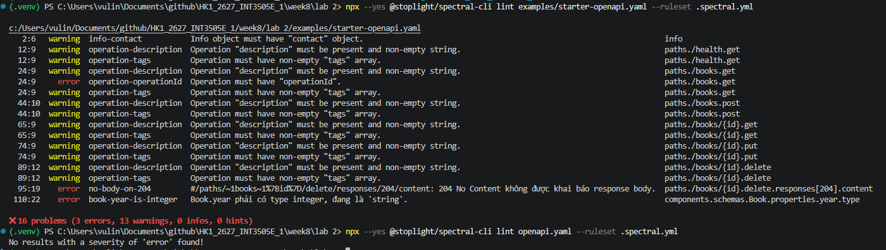
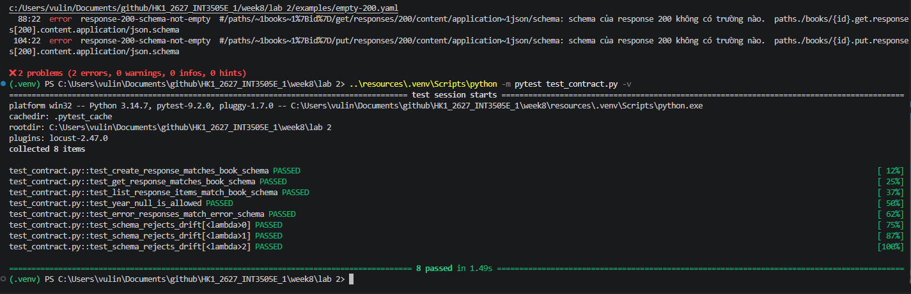

# Lab 2 — Lint OpenAPI bằng Spectral

## 1. Spectral lint: trước và sau khi sửa 3 lỗi

- **Trước** (`examples/starter-openapi.yaml`): **16 problems (3 errors, 13 warnings)**. Ba error đúng là 3 lỗi cố ý:
  - `operation-operationId`: `GET /books` thiếu `operationId`
  - `no-body-on-204`: `DELETE /books/{id}` khai báo body cho response 204
  - `book-year-is-integer`: `Book.year` có type `string`
- **Sau** (`openapi.yaml`): `No results with a severity of 'error' found!`, tức **0 problem**.

## 2. Custom rule và contract test

- **Custom rule `response-200-schema-not-empty`**: lint `examples/empty-200.yaml`, một spec cố tình để schema response 200 rỗng (`{type: object}`). Rule báo **2 errors** ở `GET` và `PUT /books/{id}`.
- **Contract test** `test_contract.py`: validate response thật của Flask theo schema trong `openapi.yaml`, kết quả **8 passed**. Đây là câu trả lời cho câu hỏi "spec qua Spectral nhưng code Flask trả sai field thì test nào bắt được": Spectral chỉ đọc file YAML, còn contract test gọi API thật và bắt được field thừa, thiếu hoặc sai kiểu.

