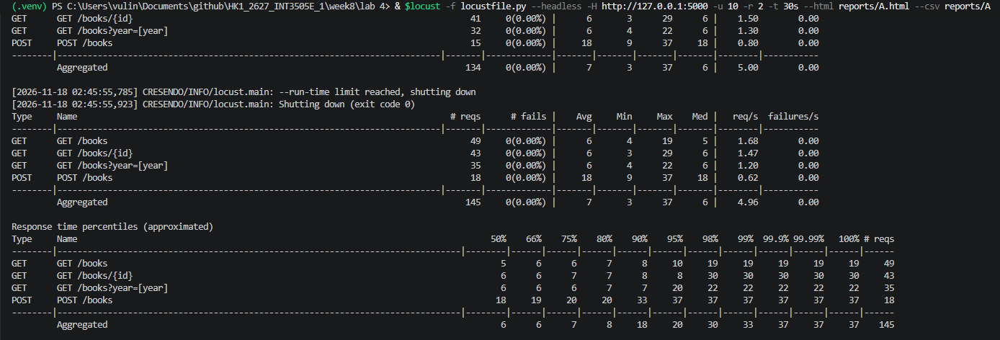
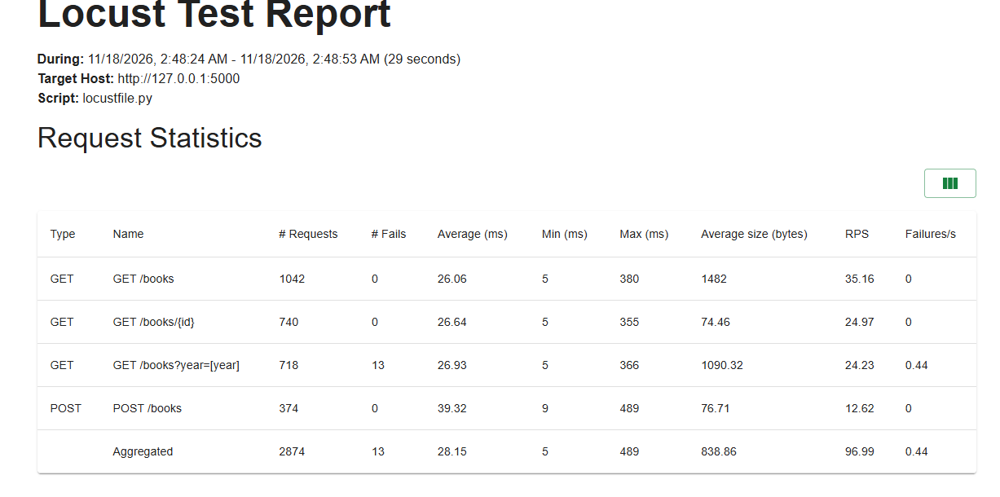
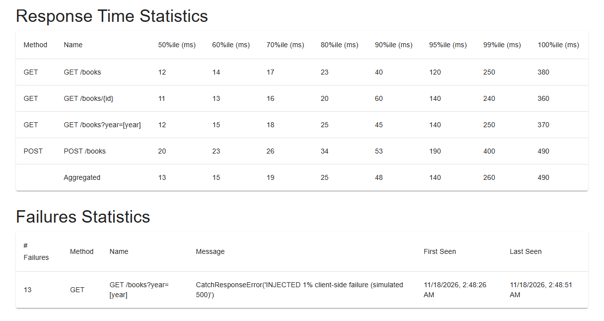
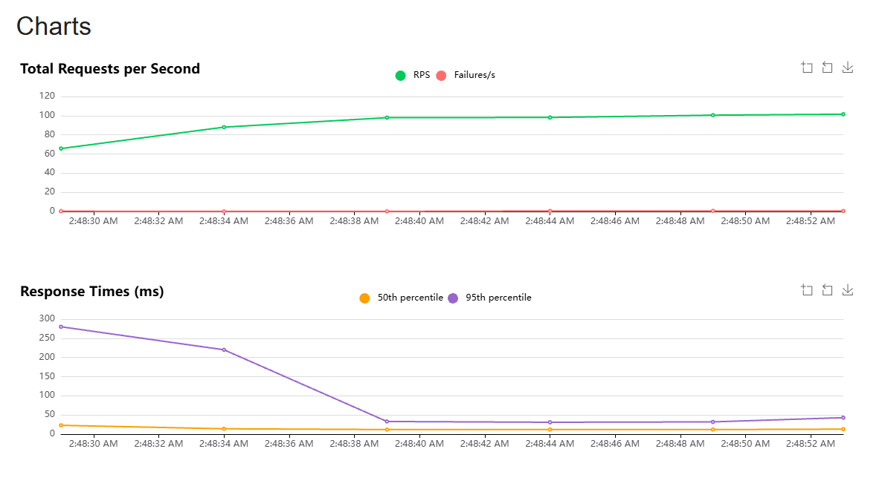
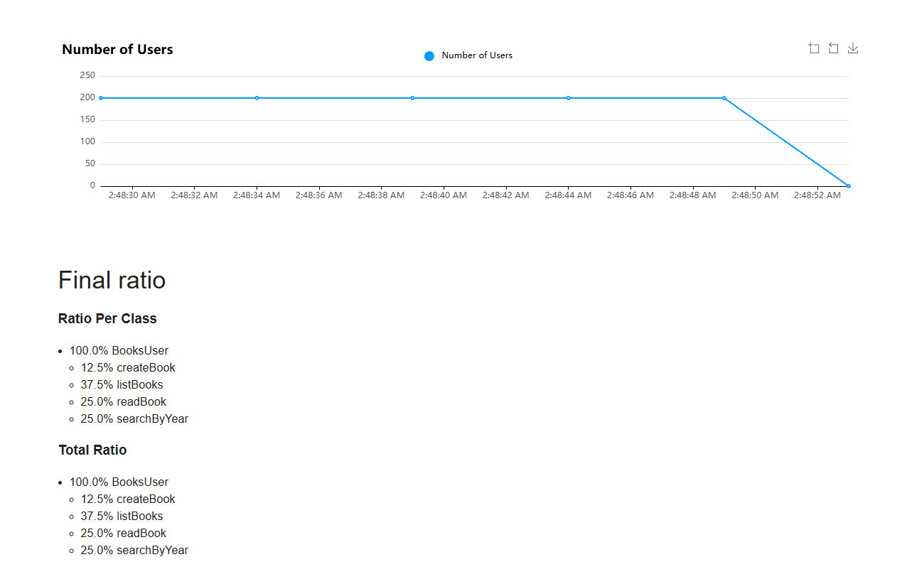

# Lab 4 — Load test Books API với Locust

## 1. Lệnh chạy

**Bonus**: server có connection pool bị giới hạn ở 5, chạy ở cổng 5001.

```powershell
cd "C:\Users\vulin\Documents\github\HK1_2627_INT3505E_1\week8\lab 4"
..\resources\.venv\Scripts\python pool_limited_server.py --port 5001
```

**Ba kịch bản bắt buộc**: chạy với API thường ở cổng 5000.

```powershell
& $locust -f locustfile.py --headless -H http://127.0.0.1:5000 -u 10 -r 2 -t 30s --html reports/A.html --csv reports/A

& $locust -f locustfile.py --headless -H http://127.0.0.1:5000 -u 50 -r 5 -t 60s --html reports/B.html --csv reports/B

& $locust -f locustfile.py --headless -H http://127.0.0.1:5000 -u 200 -r 50 -t 30s --html reports/C.html --csv reports/C
```

**Mở report HTML** của kịch bản C:

```powershell
start reports\C.html
```

## 2. Kịch bản A — baseline (10 users, spawn 2/s, 30s)

Output Locust trên terminal: **145 requests, 0 fail (0.00%)**, khoảng **5 req/s**, p95 tổng **20 ms**.



## 3. Kịch bản C — spike test (200 users, spawn 50/s, 30s)

### 3.1. Request Statistics

Kịch bản C có **2 874 requests** với khoảng **97 RPS**. Chỉ có **13 failure**, và tất cả nằm ở `GET /books?year=[year]`.



### 3.2. Response Time Statistics và Failures Statistics

p95 tổng là **140 ms**; endpoint chậm nhất là `POST /books` với p95 190 ms. Cả hai vẫn dưới SLO 300 ms.

13 failure đều có thông điệp `INJECTED 1% client-side failure (simulated 500)`. Đây là lỗi **giả lập phía client** do Locust đánh dấu; server vẫn trả HTTP 200, nên không phải HTTP 500 thật.



### 3.3. Charts: RPS và Response Times theo thời gian

RPS tăng dần lên khoảng 100 rồi ổn định. p95 cao nhất ở đầu bài test (~280 ms), khi 200 user được spawn gần như cùng lúc, sau đó giảm xuống ~30–40 ms khi tải ổn định.



### 3.4. Number of Users và tỉ lệ task

Số user giữ ở mức 200 trong suốt bài test. Tỉ lệ task đúng với trọng số trong `locustfile.py`:

| Task | Trọng số | Tỉ lệ |
|---|---:|---:|
| `listBooks` | 3 | 37.5% |
| `readBook` | 2 | 25% |
| `searchByYear` | 2 | 25% |
| `createBook` | 1 | 12.5% |


