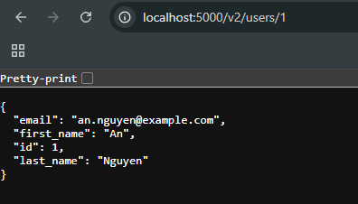
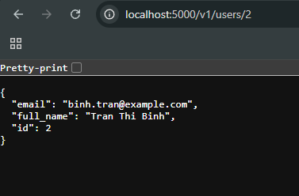

# Practice 1 — URI Path Versioning: User API v1 → v2 với Flask Blueprint

Cùng `GET /users/{id}` nhưng 2 schema khác nhau qua 2 Blueprint:

- **v1** (`/v1/users/{id}`): `full_name`.
- **v2** (`/v2/users/{id}`): `first_name` + `last_name`. Đây là **breaking change** so với v1, nên phải tách thành version mới.

Dữ liệu dùng chung một nguồn: `blueprints/users_data.py`.

## 1. Kết quả GET cùng user qua 2 version

`GET /v2/users/1` trả về schema v2 (`first_name`, `last_name`):



`GET /v1/users/2` trả về schema v1 (`full_name`):



## 2. Phần mở rộng

| # | Yêu cầu | Cách làm |
|---|---|---|
| 1 | `POST /users` cho v2 | `POST /v2/users` trong `blueprints/v2.py`: validate `first_name`, `last_name`, `email`, trả `201` kèm header `Location`. User tạo qua v2 vẫn đọc được qua v1, vì `full_name` được suy ra khi tạo |
| 2 | OpenAPI spec | [openapi.yaml](openapi.yaml): mô tả cả 2 version; v1 đánh dấu `deprecated: true` và khai báo các header `Sunset`, `Deprecation`, `Link` |
| 3 | Sunset header khi v1 sắp tắt | `after_request` trên blueprint v1 gắn `Sunset: Thu, 31 Dec 2026 23:59:59 GMT` (RFC 8594), `Deprecation: true` và `Link: </v2/users>; rel="successor-version"` cho **mọi** response của v1. v2 không có các header này |

## 3. Cách chạy

Từ thư mục gốc repo (dùng `.venv` của repo):

```powershell
cd "week9\lab 1"
..\..\.venv\Scripts\python app.py
```

Chạy test (**9 passed**):

```powershell
..\..\.venv\Scripts\python -m pytest -v
```

## 4. curl và kết quả

Các lệnh dưới đây chạy được trong Git Bash; trên PowerShell hãy dùng `curl.exe`. Kết quả là output thật, đã bỏ bớt các header `Date`/`Server`.

**v1 có Sunset header**

```bash
curl -i localhost:5000/v1/users/1
```

```http
HTTP/1.1 200 OK
Content-Type: application/json
Sunset: Thu, 31 Dec 2026 23:59:59 GMT
Deprecation: true
Link: </v2/users>; rel="successor-version"

{"email":"an.nguyen@example.com","full_name":"Nguyen Van An","id":1}
```

**v2 không có Sunset header**

```bash
curl -i localhost:5000/v2/users/1
```

```http
HTTP/1.1 200 OK
Content-Type: application/json

{"email":"an.nguyen@example.com","first_name":"An","id":1,"last_name":"Nguyen"}
```

**POST /v2/users**

```bash
curl -i -X POST localhost:5000/v2/users -H "Content-Type: application/json" \
  -d '{"first_name":"Dung","last_name":"Pham","email":"dung.pham@example.com"}'
```

```http
HTTP/1.1 201 CREATED
Content-Type: application/json
Location: /v2/users/4

{"email":"dung.pham@example.com","first_name":"Dung","id":4,"last_name":"Pham"}
```

User vừa tạo cũng đọc được qua v1:

```bash
curl localhost:5000/v1/users/4
```

```json
{"email":"dung.pham@example.com","full_name":"Pham Dung","id":4}
```

**POST thiếu field → 400**

```bash
curl -i -X POST localhost:5000/v2/users -H "Content-Type: application/json" -d '{"first_name":"Dung"}'
```

```http
HTTP/1.1 400 BAD REQUEST
Content-Type: application/json

{"error":"Missing or empty fields","fields":["last_name","email"]}
```
